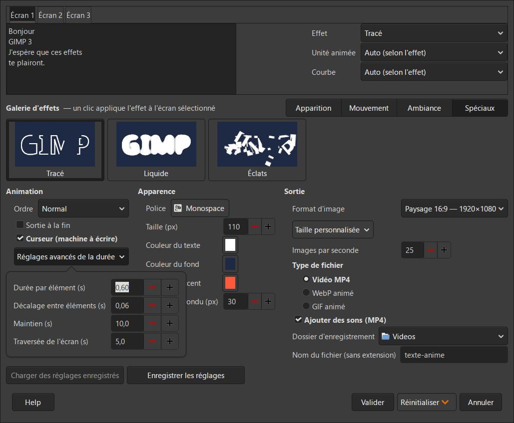

# Texte animé — un greffon pour GIMP 3

**[English version → README.md](README.md)**

Créez des titres animés directement dans GIMP 3 : saisissez votre texte, choisissez un effet dans la galerie, puis exportez une **vidéo MP4** (avec bruitages), un **WebP animé** ou un **GIF animé**.



## Fonctionnalités

- **18 effets** dans une galerie avec des aperçus animés (survolez une vignette pour la lire).
- **Jusqu'à 3 écrans** à la suite, chacun avec son texte et son effet.
- **Un réglage du temps comme dans un logiciel de motion design** : animation par lettre, mot, ligne ou bloc entier ; choix de la courbe (douce, dépassement, élastique, ricochet) et de l'ordre (normal, inverse, depuis le centre, aléatoire).
- **Formats d'image prêts à l'emploi** : carré 1:1 (1080×1080), paysage 16:9 (1920×1080 ou 1280×720), portrait 9:16 (1080×1920), vertical 4:5 (1080×1350), ou personnalisé.
- **Bruitages pour le MP4** : frappe de touches, souffles, impacts, grésillement de néon… Ils sont fabriqués par le greffon lui-même : aucun fichier audio externe, donc aucune question de droits. On peut les désactiver.
- **Gestion des textes longs** : les lignes passent à la ligne automatiquement, et la taille diminue si besoin pour que le texte reste dans l'image.
- **Fenêtre d'attente** avec une grande barre de progression, une estimation du temps restant et un bouton Annuler. À la fin, un bouton ouvre le dossier qui contient le fichier.
- **Enregistrement sans mauvaise surprise** : le greffon demande avant de remplacer un fichier existant, avec la possibilité de garder les deux.
- **Interface bilingue** : en français si GIMP est en français, en anglais sinon.

## Effets

| Apparition | Mouvement | Ambiance | Spéciaux |
|---|---|---|---|
| Fondu | Chute | Néon | Tracé |
| Fondu flou | Alterné | Mise au point | Liquide (morphing) |
| Machine à écrire | Glisser | Parallaxe | Éclats |
| Rideau | Stomp | Générique | |
| Remplissage | Traînée (flou de mouvement) | Bandeau | |

| | | | |
|---|---|---|---|
|  Fondu |  Machine à écrire |  Rideau |  Remplissage |
|  Chute |  Stomp |  Traînée |  Néon |
|  Mise au point |  Tracé |  Liquide |  Éclats |

Quelques précisions sur les effets les plus particuliers :

- **Liquide** : quand deux écrans à la suite utilisent *Liquide*, le premier texte fond et se reforme en le second (morphing).
- **Tracé** : le greffon suit le *contour* de chaque lettre, comme un détourage animé. Il n'imite pas l'écriture à la main, qui demanderait des polices spéciales à trait unique.
- **Éclats** : cet effet est nettement plus lent à créer que les autres.

## Prérequis

- **GIMP 3.2**. Le greffon a été développé et testé avec GIMP 3.2.4 sous Windows 11. Les autres versions et les autres systèmes n'ont pas été testés.
- **ffmpeg**, uniquement pour l'export MP4. Le WebP et le GIF sont exportés par GIMP lui-même. Voir [Installer ffmpeg](#installer-ffmpeg) ci-dessous.

## Installer ffmpeg

ffmpeg est un outil gratuit qui assemble les images en vidéo. Le greffon l'appelle au moment de l'export MP4. Il doit donc être **installé et accessible depuis n'importe quel dossier** : c'est ce qu'on appelle être « dans le PATH ».

### Windows — méthode 1 : winget (recommandée)

winget est le gestionnaire de logiciels intégré à Windows 10 et 11. Il télécharge, installe et rend ffmpeg accessible en une seule commande.

1. Ouvrez **PowerShell** : menu Démarrer, tapez `powershell`, puis Entrée. Les droits administrateur ne sont pas nécessaires.
2. Tapez :
   ```powershell
   winget install Gyan.FFmpeg
   ```
3. La première fois, winget peut demander d'accepter les conditions de son catalogue : tapez `Y` puis Entrée.
4. winget télécharge ffmpeg (la version pour Windows de gyan.dev, celle recommandée par le site officiel), vérifie le fichier, l'installe dans votre dossier utilisateur et l'ajoute au PATH.
5. **Fermez PowerShell, rouvrez-le** et vérifiez :
   ```powershell
   ffmpeg -version
   ```
   Si des informations de version s'affichent, ffmpeg est prêt.
6. **Relancez GIMP** s'il était ouvert : il ne voit ffmpeg qu'après un redémarrage.

Commandes utiles par la suite :
```powershell
winget upgrade Gyan.FFmpeg     # mettre à jour ffmpeg
winget uninstall Gyan.FFmpeg   # désinstaller ffmpeg
```

> **« winget n'est pas reconnu… »** : installez ou mettez à jour l'application **App Installer** depuis le Microsoft Store, puis recommencez. Si winget reste indisponible (PC professionnel verrouillé par exemple), utilisez la méthode 2.

### Windows — méthode 2 : téléchargement depuis le site web

Le site officiel [ffmpeg.org](https://www.ffmpeg.org/download.html) ne propose que le code source. Pour Windows, il renvoie vers des versions prêtes à l'emploi, dont celles de **gyan.dev**.

1. Allez sur [gyan.dev/ffmpeg/builds](https://www.gyan.dev/ffmpeg/builds/). Depuis ffmpeg.org, c'est le lien « Windows builds from gyan.dev ».
2. Dans la partie **release builds**, téléchargez **`ffmpeg-release-essentials.zip`**. La version *essentials* suffit pour le greffon.
3. Décompressez l'archive. Renommez le dossier obtenu (par exemple `ffmpeg-8.1-essentials_build`) en **`ffmpeg`** et placez-le à la racine du disque. Vous devez obtenir le fichier `C:\ffmpeg\bin\ffmpeg.exe`.
4. Ajoutez le dossier `bin` au PATH :
   1. Menu Démarrer, tapez `variables d'environnement` et ouvrez **Modifier les variables d'environnement pour votre compte**.
   2. Dans la liste du haut, sélectionnez **Path** puis cliquez sur **Modifier…**
   3. Cliquez sur **Nouveau** et saisissez `C:\ffmpeg\bin`.
   4. Validez avec **OK** dans chaque fenêtre.
5. Ouvrez une **nouvelle** fenêtre PowerShell et vérifiez avec `ffmpeg -version`.
6. **Relancez GIMP.**

Pour mettre à jour, téléchargez la nouvelle archive et remplacez le contenu de `C:\ffmpeg`. Pour désinstaller, supprimez `C:\ffmpeg` et retirez la ligne `C:\ffmpeg\bin` du Path.

### macOS et Linux

- macOS (avec [Homebrew](https://brew.sh)) : `brew install ffmpeg`
- Linux : `sudo apt install ffmpeg` (ou l'équivalent de votre distribution)

### En cas de problème

Si le greffon indique que ffmpeg est introuvable alors qu'il est installé :
- vérifiez que `ffmpeg -version` fonctionne dans une **nouvelle** fenêtre PowerShell ;
- fermez **complètement** GIMP puis relancez-le ;
- en dernier recours, redémarrez l'ordinateur pour que Windows prenne en compte le nouveau PATH.

## Installation

1. Téléchargez ce dépôt (bouton vert **Code** → **Download ZIP**) et décompressez-le.
2. Copiez le dossier **`texte-anime`** en entier, avec son sous-dossier `apercus`, dans le dossier des greffons de GIMP :
   - Windows : `%APPDATA%\GIMP\3.2\plug-ins\`
   - Linux : `~/.config/GIMP/3.2/plug-ins/`
   - macOS : `~/Library/Application Support/GIMP/3.2/plug-ins/`
3. Sous Linux et macOS, rendez le script exécutable : `chmod +x texte-anime.py`
4. Relancez GIMP.

Le dossier doit garder le nom `texte-anime`, le même que celui du script. GIMP l'exige.

## Utilisation

1. **Fichier → Créer → Animation → Texte animé…**
2. Dans l'onglet **Écran 1**, saisissez votre texte. La touche Entrée crée une nouvelle ligne.
3. Cliquez sur un effet dans la galerie. Les onglets **Apparition / Mouvement / Ambiance / Spéciaux** rangent les effets.
4. Réglez l'apparence (police, taille, couleurs) et la sortie (format d'image, type de fichier, dossier, nom du fichier).
5. Cliquez sur **Valider**. Une fenêtre montre où en est la création.

### Astuces

- **N'utiliser qu'un ou deux écrans** : laissez vide le texte de l'écran 2 ou 3, ou décochez **Inclure cet écran**. Son texte est alors conservé pour plus tard. L'onglet affiche « — inactif ».
- **Réglages avancés de la durée** et **Taille personnalisée** s'ouvrent dans des bulles flottantes : la fenêtre ne change jamais de taille.
- **Nom du fichier** : tapez juste un nom, par exemple `intro`. L'extension (.mp4, .webp, .gif) est ajoutée automatiquement.
- **Couleur d'accent** : elle sert à trois effets (le volet du Rideau, le halo du Néon et le cadre de la Mise au point).
- **Survolez** un réglage pour afficher une bulle d'aide qui l'explique.

## Lire les fichiers et choisir un format

| Format | Pour l'ouvrir | Idéal pour | Limites |
|---|---|---|---|
| **MP4** | N'importe quel lecteur vidéo (Lecteur multimédia de Windows, VLC…), tous les navigateurs, toutes les plateformes vidéo | Réseaux sociaux, YouTube, montage vidéo, PowerPoint (insertion d'une vidéo) | Ne tourne pas en boucle tout seul dans une page web ou un e-mail ; dans un e-mail, c'est une pièce jointe, pas une image affichée |
| **WebP animé** | Tous les navigateurs récents (Chrome, Edge, Firefox, Safari depuis macOS Big Sur) ; des visionneuses comme XnView MP ou IrfanView (avec ses plugins) ; GIMP (ouverture en calques : **Filtres → Animation → Rejouer**) | Sites web et documentation : fichiers légers, couleurs complètes | Pas de son. L'Explorateur Windows n'affiche qu'une miniature fixe. Pas reconnu partout : Outlook sur ordinateur, certains réseaux sociaux, certaines versions de PowerPoint |
| **GIF animé** | Partout : navigateurs, visionneuses, e-mails, PowerPoint, messageries | E-mail, PowerPoint, compatibilité maximale | Pas de son. 256 couleurs seulement : les dégradés, halos et flous font des bandes visibles (Néon, Fondu flou, Liquide). Fichiers bien plus lourds que le WebP. Transparence en tout ou rien |

Le plus simple pour vérifier un WebP animé sous Windows : le glisser dans Edge ou Chrome.

## Limites connues

- **L'encodage WebP et GIF** se fait en un seul appel à GIMP. Pendant cette étape, la barre reste à 85 % et le bouton Annuler n'agit plus.
- **Le temps de création** dépend du format d'image et de l'effet : de quelques secondes à environ une minute en 1280×720. Le Fondu flou, le Tracé et les Éclats sont les plus lents.
- **Le WebP et le GIF n'ont pas de son.** Seul le MP4 peut contenir les bruitages.

## Contournements de problèmes de GIMP 3.2

Ces notes peuvent servir à d'autres auteurs de greffons :

- **Les couleurs par défaut sont perdues** à l'enregistrement d'un paramètre de couleur. Le greffon les rétablit au lancement.
- **Les paramètres de dossier font planter GIMP sous Windows** : un paramètre dossier (`GFile`) est enregistré avec des barres obliques inverses que GIMP ne sait pas relire, ce qui fait planter le lancement suivant. Le dossier est donc enregistré comme du texte simple.
- **Les polices ne sont pas forcément prêtes** quand GIMP est lancé en mode console (traitement par lots). Le greffon attend qu'elles soient chargées.
- **Remplir une sélection vide remplit tout le calque.** Chaque rectangle est limité à l'image avant d'être dessiné.
